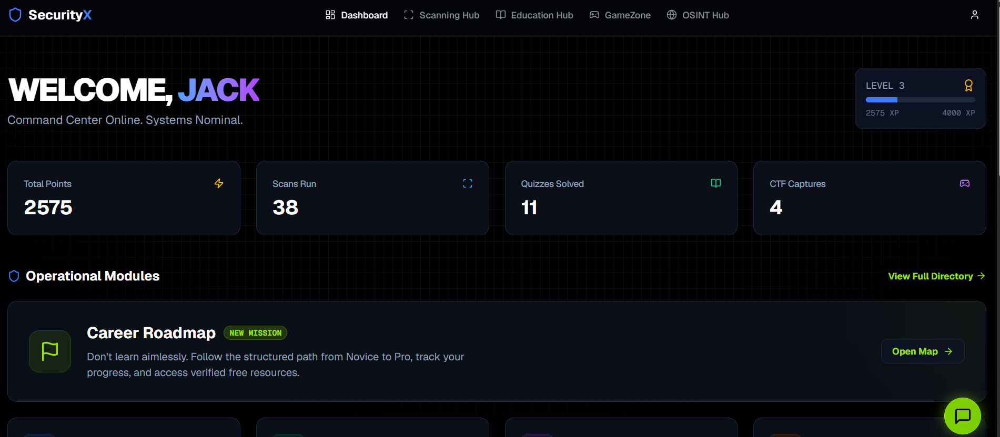
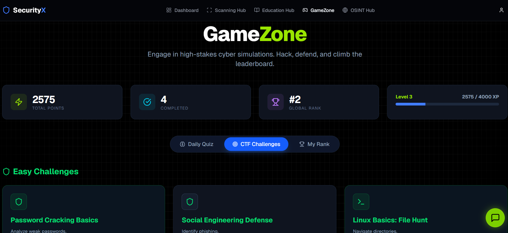
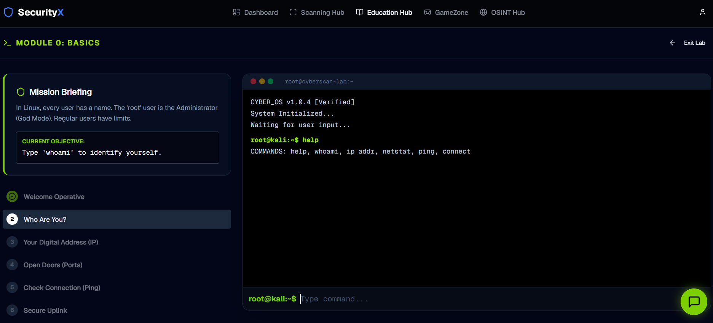

# SecurityX

> A beginner-friendly cybersecurity learning platform with interactive lessons, safe simulations, quizzes, and gamified challenges.

SecurityX, formerly CyberScan AI, helps newcomers understand core cybersecurity concepts through guided learning experiences—not by pretending to be a replacement for professional security tools.

## What SecurityX is

SecurityX is designed for students and beginners who want one place to:

- Learn cybersecurity foundations and common security concepts.
- Complete quizzes and safe interactive challenges.
- Explore how security reports, OSINT records, and threat-analysis interfaces are structured.
- Track learning progress, points, challenges, and badges.
- Practice ethical and defensive cybersecurity thinking.

## Important: educational use only

SecurityX includes simulated OSINT reports, file-name awareness checks, and AI-assisted analysis experiences.

These features are for learning and demonstration purposes only:

- They do not confirm that an email was involved in a breach.
- They do not perform live WHOIS, DNS, social-profile, or dark-web intelligence lookups.
- They do not replace malware scanners, threat-intelligence platforms, penetration tests, or professional security advice.
- Do not use any result from SecurityX to make real-world security decisions.

Always use only systems, accounts, and data you own or have explicit permission to assess.

## Features

### Learn Hub

- Beginner-focused cybersecurity articles and learning modules.
- Interactive lessons covering topics such as networking, authentication, encryption, phishing awareness, and web security.
- Cybersecurity news feed.
- Learning roadmap and progress tracking.

### Scanning Workspace

- URL, IP, image, and file-name awareness activities.
- SHA-256, SHA-512, MD5, and Base64 utilities.
- AI-assisted explanations of possible risk indicators.
- Downloadable learning reports.

### OSINT Learning Simulators

- Breach Exposure Simulator.
- WHOIS Report Simulator.
- DNS Record Simulator.
- Metadata Learning Lab.
- Social Footprint Simulator.
- Email Pattern Simulator.

All OSINT modules use generated training scenarios and are clearly intended for educational use.

### GameZone

- Cybersecurity quizzes with explanations.
- Beginner-friendly CyberDojo challenges.
- Linux command practice scenarios.
- Points, levels, progress tracking, and leaderboard features.

### User Experience

- Firebase email/password and Google authentication.
- Personal profile and learning dashboard.
- Optional push notifications.
- Responsive dark cybersecurity-themed interface.
- Progressive Web App support.

## Tech Stack

- Next.js App Router
- TypeScript
- React
- Tailwind CSS
- Framer Motion
- Firebase Authentication
- Cloud Firestore
- Firebase Realtime Database
- Firebase Cloud Messaging
- Groq API for AI-assisted explanations
- Vercel Analytics and Speed Insights
- Capacitor for Android packaging

## Screenshots

## Roadmap

- [ ] Guided beginner learning path
- [ ] More defensive coding challenges
- [ ] Stronger server-side GameZone scoring
- [ ] Privacy-safe public profile architecture
- [ ] Tested Firestore security rules
- [ ] More accessible learning content
- [ ] Improved mobile and Android experience
- [ ] Optional real integrations with transparent source and consent controls

## Disclaimer

SecurityX is an educational cybersecurity platform. It is not a substitute for professional security assessment, incident response, vulnerability management, or threat intelligence services.

Use responsibly, ethically, and only with explicit authorization.

---

Built by the SecurityX team.
